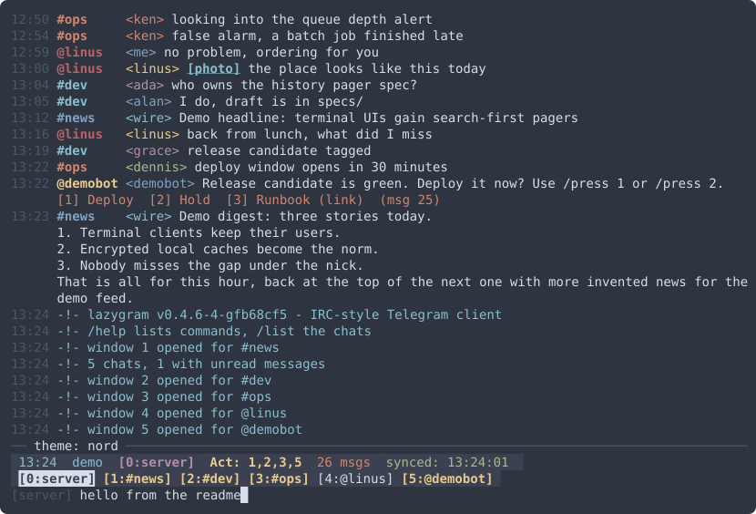

# lazygram

[](https://github.com/t0d0r/lazygram/actions/workflows/linux.yml)
[](https://github.com/t0d0r/lazygram/actions/workflows/macos.yml)
[](https://github.com/t0d0r/lazygram/releases)

A local terminal client for chat services, Telegram first. It shows messages
from all your chats as one chronological scrollback, like a single IRC
channel (BitchX / irssi style), and lets you open the full history of any chat
in a searchable pager. Feature goals are inspired by nchat.

## Features

- Telegram over MTProto (gotd): QR login like the desktop apps, no phone
  number typed, the two-step password asked once; a registration ships in
  the source, your own wins when set
- IRC-style windows: window 0 is the server window with every chat
  interleaved, one window per chat, window bar, `Act:` list, `/list`,
  `/win`, `/move`, `/close`; layout and settings remembered across runs
- Sending: Ctrl-X sends, a double Ctrl-X makes Enter send per window,
  `/me`, `/msg`, `/edit` and `/delete` of your last message, input
  history, bash-style Tab completion (commands, chats, themes, paths)
- Bots: `/press` answers inline and reply buttons, link buttons are printed
- Attachments: nothing downloads until you click or `/open`; files land in
  an encrypted vault, pictures are painted inside the terminal, `/open out`
  for the system viewer; `/send <path>` uploads photos and files
- History: `/last`, `/search` pager over the local history, `/whois`,
  `/stats`, `/about`, `/names` (nicks or titles)
- Encrypted SQLite cache (AES-256-GCM per row) keyed from the session, so
  it is unreadable without `session.json`; see specs/security.md for the
  full list of what is and is not stored
- Mouse: clickable names, links, window tags, list rows and `[photo]`
  tokens with running lights under the pointer; `/mouse` and `/fx` toggles
- Looks: nine colour themes, BitchX-style banners that roll in like a slow
  serial line, a random parting face and session statistics at exit
- `lazygram demo` with invented data, `lazygram update` (brew or binary,
  checked against SHA256SUMS), static binaries for Linux and macOS, an
  Arch Linux / Omarchy package recipe

## Screenshots

The demo (`lazygram demo`, invented data), `nord` theme: the server window
with every chat interleaved, bot buttons and a `[photo]` token.



## Install

```sh
brew install t0d0r/tap/lazygram
```

Arch Linux and Omarchy: an Arch package recipe lives in
`packaging/omarchy/lazygram` (`makepkg -si` there builds and installs it;
once it is in pkgs.omarchy.org, `omarchy pkg add lazygram`). See
[docs/arch-omarchy.md](docs/arch-omarchy.md) for launching from the Omarchy
menu, troubleshooting, upgrade and uninstall.

Or download a static binary for Linux or macOS from the
[releases](https://github.com/t0d0r/lazygram/releases) (`uname -m`:
`x86_64` is amd64, `aarch64`/`arm64` is arm64):

```sh
V=v0.3.0 A=darwin-arm64
curl -LO https://github.com/t0d0r/lazygram/releases/download/$V/lazygram-$V-$A.tar.gz
curl -LO https://github.com/t0d0r/lazygram/releases/download/$V/SHA256SUMS
shasum -a 256 -c SHA256SUMS --ignore-missing   # sha256sum on Linux
tar -xzf lazygram-$V-$A.tar.gz
install -m 0755 lazygram-$V-$A/lazygram ~/.local/bin/
```

Or build from source: `make build` (needs Go), `make install` copies it to
`~/.local/bin`.

Update later with `lazygram update`: it upgrades through brew when
installed that way, otherwise replaces the binary with the latest release
after checking it against the release's SHA256SUMS. `lazygram update -check`
only reports; `-yes` skips the question. A build from source is never
replaced, and neither is a binary installed by a package manager (pacman):
those update through the package manager (from v0.4.15; on 0.4.14 the
command stops with a permission error, do not rerun it with sudo).

## Quick start

```sh
lazygram login    # link your Telegram account: scan a QR code with the phone app
lazygram          # read your chats
lazygram demo     # or try it with invented data, no account needed
```

Started without a linked account, lazygram exits and says how to link one or
how to start the demo. No environment variables are required. Everything
lazygram keeps lives in one state directory, `~/.local/state/lazygram` (or
`-data DIR`), which is private to you and never committed. `make run`,
`make demo`, `make login` and `make smoke` use `.state/` inside the project.

### Linking an account

`lazygram login` works like nchat and the official desktop apps: it shows a
QR code in the terminal; on the phone open Telegram, Settings -> Devices ->
Link Desktop Device, and scan it. No phone number or SMS code is typed. If the
account has two-step verification, the password is asked once, hidden. Use
`-ascii` if the block characters do not render in your terminal.

Telegram's protocol requires every client to identify with an application
id and hash. Like nchat, lazygram ships one in its source, so a brew or
source build logs in with nothing to configure. If you prefer your own
(forks must: a registration shared by many clients can be throttled or
banned by Telegram), get it from https://my.telegram.org under "API
development tools" and give it to lazygram in one of three ways; each wins
over the built-in one:

- `TG_API_ID` and `TG_API_HASH` in the environment, for example from a
  direnv `.envrc` in the project directory (git-ignored). `lazygram login`
  takes them from there, stores them in the state directory and never asks.
  nchat's names `TG_APIID` / `TG_APIHASH` are accepted too.
- Type them at the first `lazygram login`; they are stored the same way.
- Bake them into the binary like nchat: `make embed` writes the git-ignored
  `cmd/lazygram/app_local.go` from `TG_API_ID`/`TG_API_HASH` in the
  environment (direnv), and every `make build` after that carries them. No
  environment at run time, no prompt.

A stored registration wins over the environment, which wins over a private
embed, which wins over the one shipped in the source; delete `<state>/telegram/app.json` to switch. Never commit these values:
`.envrc`, `*_local.go` and `.state/` are git-ignored for that reason.

## Using it

It works like BitchX/irssi, down to the banner at start and the parting
one at exit (one of several faces, at random), both rolling in line by
line like a terminal on a slow serial line.
Window 0 is the server window: every chat
interleaved by time as `HH:MM #chat <sender> text`, plus `-!-` notices. A
window bar above the input lists every window as `[N:name]`. Open windows,
the current one and each window's Enter-sends setting are remembered
across restarts. On exit lazygram prints the session statistics (time
wasted, messages, windows, commands) and, for a release build, a hint when
a newer release exists; `/about` shows version, author and build.
When a chat gets a message (or has unread messages at start) a window opens
for it; the status line shows `[Act: 2,3]` for windows with unread. People
are `@name`, groups and channels are `#name`. lazygram shows what arrives
while it runs; opening a chat's window fetches its last 10 messages, and
`/last N` fetches more.

| command                    | action                                        |
|----------------------------|-----------------------------------------------|
| `/list [text]`             | selectable chat list; Enter opens the window; `--show-deleted` includes deleted accounts |
| `/win N`                   | switch to window N (0 is the server window)   |
| `/move N`                  | move this window to position N                |
| `/win @user`, `/win #chan` | open or switch to that chat's window          |
| `/win`, `/win list`        | selectable list of the open windows           |
| `/close [N]`               | close a window                                |
| `/last [N]`                | fetch the last N messages of this chat        |
| `/search [text]`           | page through this chat's local history        |
| `/whois [name]`            | what is known about a chat                    |
| `/stats`                   | client statistics                             |
| `/me <text>`               | send an action line (`* you waves`)           |
| `/msg <@user|#chan> <text>` | send to a chat, opening its window if needed |
| `/send <path> [caption]`   | send a local file (Tab completes the path); pictures go as photos |
| `/edit [text]`, `/delete`  | change or remove your last message in this chat |
| `/names`                   | show chats by nick (`@alias`) or by name (`@Title`) |
| `/press N`                 | press button N under the latest bot message; `/press <msg> N` for an older one |
| `/open [msg]`              | fetch a `[photo]`/`[file]` into the encrypted vault; pictures are shown in the window (`/open out` for the system viewer) |
| `/theme [name]`            | colour themes: default, solarized, gruvbox, dracula, nord, monokai, tokyonight, vim, emacs; for light terminals: light, solarized-light, gruvbox-light |
| `/about`                   | version, author, build and libraries          |
| `/fx`                      | running lights over links and buttons on/off  |
| `/mouse`                   | mouse reporting on/off (off: drag selects text; or hold Shift/Option while dragging) |
| `/redraw`, `/clear`        | drop notices, help text and pictures from this window; messages stay |
| `/refresh`, `/help`, `/quit` | sync now; print the help into the server window; leave |

In a chat window, type text and press **Ctrl-X** to send it to that chat;
Enter is for commands (press Ctrl-X twice quickly to make Enter send in
that window, and again to switch back; a fast double Ctrl-X never sends,
it only switches; the status line ends with `ctrl-x: to send` or
`enter: to send`). The sent line shows up as `<me>` once the service
has it. Bot messages with buttons show them underneath as
`[1] Yes  [2] Docs (link)  (msg 1234)`; `/press 1` answers the bot and the
edited message replaces the old line, link buttons only print their URL,
reply-keyboard buttons send their label. Photos show as `[photo]`: click
the token or `/open` and the picture is painted inside the window from
memory (nothing is written to disk); `/open out` opens it in the system
viewer instead.

| key                 | action                                             |
|---------------------|----------------------------------------------------|
| Tab                 | empty prompt: next window (Shift-Tab previous); else complete like bash: commands, chats, themes, `/open out` and attachment message ids, `/win list`, paths after `/send` |
| Ctrl-N / Ctrl-P     | next / previous window (Alt-Right / Alt-Left too)  |
| Alt-0 .. Alt-9      | window 0 .. 9 (Esc then the digit works too)       |
| Up / Down           | input history (commands and sent lines)            |
| Left / Right        | move the cursor in the input; Ctrl-A / Ctrl-E start / end; Delete removes under the cursor (as Backspace at the end), Ctrl-W the word before it, Ctrl-K to the end |
| PgUp / PgDn         | scroll a page; Home / End oldest / newest          |
| Ctrl-R              | sync now                                           |
| F1                  | print the help into the server window              |
| Esc                 | close the list or pager, else clear the input      |
| Ctrl-X              | send the typed text to this window's chat          |
| Ctrl-X twice        | toggle "Enter sends" for this window               |
| Ctrl-C              | quit                                               |
| mouse               | click chat names, nicks, window tags, list rows, links and `[photo]` tokens (a running light shows what is under the pointer); wheel scrolls |

## Development

```sh
make check    # gofmt + go vet + golangci-lint + tests
make smoke    # non-interactive: demo sync once, print one screen, exit
make dist     # release tarballs + SHA256SUMS into dist/ (never with your registration)
make help     # all targets
```

Releases: tag `vX.Y.Z`, `make dist`, `make release` (uses `gh`), then bump
the formula in [t0d0r/homebrew-tap](https://github.com/t0d0r/homebrew-tap).
See specs/release.md.

## License

BSD 2-Clause (the FreeBSD license). See `LICENSE`.
